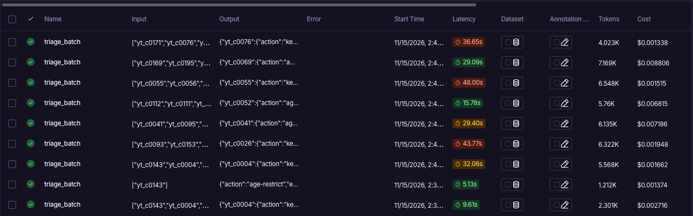

# zero-university-project-1

First project for the Zero University Applied AI Engineer program: a small Python project using pandas.

## Setup

```bash
python3 -m venv .venv
source .venv/bin/activate
pip install -r requirements.txt
cp .env.example .env   # then add your real values
```

## Run

```bash
python main.py
```

## Verdict

Clip identity (assumed): yt_c0143, "Clashes outside parliament as fuel price protest turns violent", is a best match for Ana's protest clip, not a confirmed one. It is the only title in the dataset containing "protest", but nothing in the data names Ana.

Raw model reply: [outputs/ana_protest_raw_reply.txt](outputs/ana_protest_raw_reply.txt)

Label: No, the model did not remove the clip; it labelled it age-restrict, which matches the ground-truth label.

Timestamps: Yes, 00:30 and 01:50 are both inside the clip's 198-second duration, and both overlap the ground-truth violent segment (0:20-2:20).

## Decision schema

The model's free-text reply breaks the enforcement policy in several ways: it has no policy reason, its evidence moments are single points with no end, and nothing stops a made-up label. Full list: [outputs/enforcement_gaps.md](outputs/enforcement_gaps.md).

[src/decision_schema.py](src/decision_schema.py) defines a decision with:

- **action**: only `keep`, `age-restrict` or `remove`
- **policy_reason**: one of the seven approved wordings, exactly as written, and only with the actions that reason permits
- **evidence**: timestamped moments (start and end in seconds, plus a description); `age-restrict` and `remove` must cite at least one

`validate_decision(data, clip_duration_seconds)` takes the clip's runtime from the dataset, never from the model. It rejects moments that run backwards, have zero length, or run past the end of the clip. Every rejection is a pydantic `ValidationError` raised by the schema itself.

### Tests

```bash
.venv/bin/python -m pytest -v
```

Five tests (7 results, because the refused-label test runs once each for `flag`, `restricted` and `review`), using Ana's real reply. The saved output, [outputs/pytest_output.txt](outputs/pytest_output.txt), covers the whole suite including the pipeline tests below (16 passed).

They cover four kinds: a refused label, evidence that runs backwards, evidence past the end of the clip, and a valid decision that survives a JSON round trip. Each rejection test is pinned to `ValidationError` and checks which field failed, so it cannot pass because of an unrelated error.

## Triage pipeline

A clip goes in, and either a clean schema decision or a loud error comes out. Every model request is traced, and the results are checked against the true labels on the news clips.

[src/triage_batch.py](src/triage_batch.py) defines `triage_batch`, which takes up to 10 clips and returns one decision per `clip_id`:

- **Prompt**: built from each clip's title, transcript and frame captions. The ground-truth columns are never sent.
- **Validation**: each decision is checked on its own through the decision schema, with that clip's `duration_seconds` from the test set.
- **Broken replies**: retried once with the errors attached. If the retry is broken too, it raises `TriageBatchError`. No clip is ever given a default label.
- **Model**: the model id is read from [config.yaml](config.yaml), not from the code.
- **Tracing**: every batch is traced to LangSmith, with the token usage and cost OpenRouter reports attached to the run.

### News clips run

[src/run_news_clips.py](src/run_news_clips.py) runs all 64 news clips in the test set, including Ana's protest clip (yt_c0143), in 7 batches.

| | |
|---|---|
| Model | `deepseek/deepseek-v4-pro` |
| Valid decisions | 64 of 64 |
| Failed | 0 |
| Label matches ground truth | 51 of 64 (80%) |
| Retries needed | 0 |
| Total cost | $0.029 |

All 13 mismatches go the same way: the model said `keep` where the ground truth is `age-restrict`. It never over-restricted.

- Terminal output, one line per clip: [outputs/news_run_output.txt](outputs/news_run_output.txt)
- Saved decisions: [outputs/news_decisions.json](outputs/news_decisions.json)
- LangSmith run list, showing cost and latency for each batch:



The top seven rows are the seven batches of the news run. The bottom two are earlier test runs: Ana's clip on its own, and a three-clip batch.

```bash
.venv/bin/python src/run_news_clips.py
```
